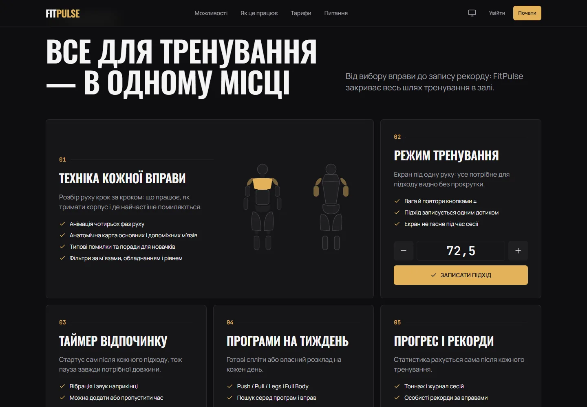
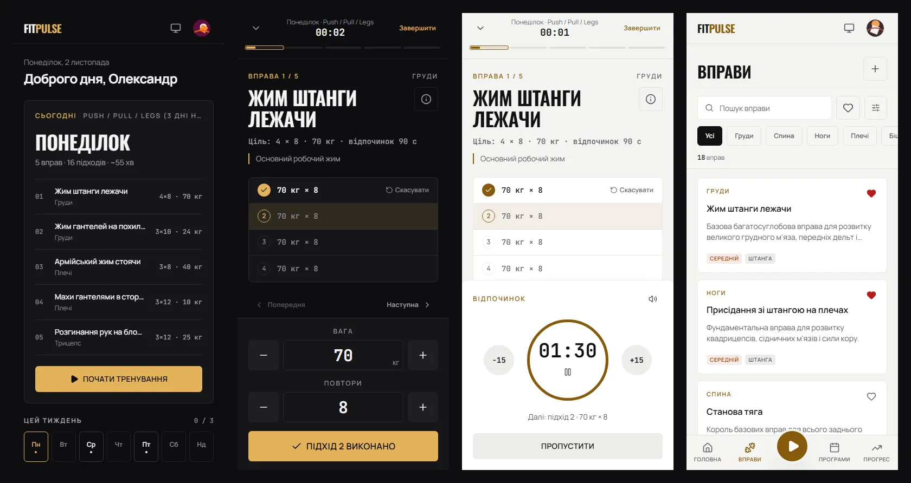

# FitPulse

Безкоштовний трекер силових тренувань для телефона в залі. Програма на тиждень, техніка кожної вправи, режим тренування з таймером відпочинку і журнал прогресу — в одному застосунку, без встановлення.

**[Відкрити демо](https://fit-pulse-beta-opal.vercel.app)**


## Можливості



| | |
|---|---|
| **Техніка вправ** | 115 вправ для залу: штанга, EZ-гриф, гантелі, гирі, Сміт, блоки, кросовер, тренажери. Варіанти одного руху зібрані в одну картку з перемикачем (жим лежачи: штанга, гантелі, Сміт, тренажер). Фото-демонстрація в темпі руху, синхронна з покроковою інструкцією; ключові моменти, типові помилки й анатомічна карта м'язів. Блок «Замінити на…» підказує схожі вправи, у тому числі під час тренування. Фільтр «обладнання у вашому залі» запам'ятовується. |
| **Режим тренування** | Повноекранний, під одну руку: вага й повтори кнопками ±, підхід записується одним дотиком. Показує результат минулого разу, оцінку 1ПМ і які блини вішати на гриф. Екран не гасне під час сесії. Вільне тренування без плану: вправи додаються по ходу, підходів скільки завгодно, а після завершення тренування можна зберегти як свою програму. |
| **Таймер відпочинку** | Стартує сам після кожного підходу, з вібрацією і звуком; час можна змінити на ±15 с або пропустити. |
| **Програми** | Бібліотека з 19 готових програм і сплітів від 2 до 6 днів на тиждень (маса, сила, схуднення, старт у залі) з фільтрами за днями й ціллю, або власний розклад. Користувач сам обирає дні тижня, на які стануть тренування програми, і може змінити їх пізніше. Пошук за назвою програми чи вправою. |
| **Публічний каталог** | Сторінки кожної вправи (`/exercise/...`) і програми (`/program/...`) та каталог (`/catalog`) відкриті без акаунта. Під час збірки для кожної генерується статичний HTML із заголовком, описом, канонічним URL і розміткою schema.org, а sitemap складається з того самого списку. |
| **Прогрес** | Графіки тоннажу по тижнях і ваги у вправі, журнал сесій, особисті рекорди рахуються автоматично. |
| **Головна** | Тренування на сьогодні з однією кнопкою старту, тиждень із виконаними й запланованими днями, підсумки. |
| **Профіль** | Фото профілю, ІМТ, денна норма калорій, вибір теми, тариф, резервна копія даних (JSON) і експорт журналу (CSV). |
| **Офлайн** | Встановлюється на головний екран як застосунок і відкривається без інтернету. |



## Документація

Як влаштований застосунок, як працюють тренування й таймери і план бекенду — зі схемами в [docs/](docs/README.md):
[архітектура](docs/architecture.md), [логіка тренувань](docs/workout-logic.md), [бекенд](docs/backend.md), [якість](docs/quality.md).

## Для кого

- **Новачкам** — щоб знати, яку вправу робити і як правильно.
- **Тим, хто тренується давно** — щоб тримати програму й бачити прогрес у цифрах, а не в зошиті.

## Тарифи

| Тариф | Статус |
|---|---|
| **Старт** | безкоштовний назавжди: каталог вправ, до 3 програм, журнал і рекорди, таймер відпочинку |
| **Pro** | у розробці: необмежені програми, розширена аналітика, синхронізація між пристроями, без реклами |
| **Тренер** | у розробці: до 20 клієнтів, призначення програм, звіти по клієнтах |

## Дизайн

- Світла, темна і «як у системі» теми; контраст тексту відповідає WCAG AA.
- Один теплий золотий акцент. Суцільна золота заливка — завжди кнопка; виконане позначається зеленим, поточне — золотим контуром.
- Mobile-first: нижня панель із кнопкою тренування на телефоні, бічна навігація на комп'ютері.
- Підтвердження й сповіщення — акуратні тости замість системних вікон.
- Доступність і SEO лендингу та входу — 100 балів у Lighthouse, перевіряється в CI.

## Дані та приватність

Бекенду поки немає: усе зберігається в браузері.

- **localStorage** — акаунт, програми, журнал, рекорди, тема.
- **sessionStorage** — стан однієї вкладки: фільтри каталогу, пошук програм, чернетка реєстрації, сторінка для повернення після входу, а також сесія без «Запам'ятати мене» (вихід після закриття вкладки).

Дані кожного акаунта зберігаються окремо, навіть якщо в одному браузері кілька людей. Паролі зберігаються лише як хеш (PBKDF2-SHA-256 із сіллю). Авторизація поки працює лише в браузері; синхронізація між пристроями потребуватиме сервера. Щоб не втратити дані при очищенні браузера, у профілі можна зберегти резервну копію.

## Технології

| | |
|---|---|
| UI | React 19, TypeScript (strict), Tailwind CSS 4 — власні компоненти без UI-бібліотек |
| Стан | Redux Toolkit 2 |
| Маршрутизація | React Router 7, сторінки застосунку завантажуються ліниво |
| Збірка | Vite 8 |
| Форми | Zod (`zod/mini`) |
| Бекенд | Fastify 5, Prisma 7, Postgres 17, Redis 7, Docker, Render |
| Якість | Oxlint, Vitest, Testing Library, Playwright, Lighthouse CI, GitHub Actions |
| Офлайн | власний service worker і web manifest |
| Інше | lucide-react, sonner |

## Запуск

Потрібен Node.js 24. Для бекенду — Docker.

### Усе разом у Docker

```bash
docker compose up
```

| Адреса | Що це |
|---|---|
| http://localhost:5173 | застосунок |
| http://localhost:5174 | адмін-панель |
| http://localhost:3000/api/health | API застосунку |
| http://localhost:3001/api/health | API адмінки |

Compose піднімає Postgres 17, Redis 7, накочує міграції й запускає обидва API та обидва фронти з перезапуском після збереження.

| Команда | Що робить |
|---|---|
| `docker compose run --rm -e SEED_ADMIN_EMAIL=you@example.com -e SEED_ADMIN_PASSWORD=... api npm run db:seed -w @fitpulse/db` | створює першого адміна |
| `docker compose run --rm -e DATABASE_URL=postgresql://fitpulse:fitpulse@db:5432/fitpulse_test api sh -c "npm run migrate:deploy -w @fitpulse/db && npm run test:integration"` | інтеграційні тести на окремій базі |

### Лише застосунок, без Docker

```bash
npm install
npm run dev -w @fitpulse/web
```

| Команда (у корені) | Що робить |
|---|---|
| `npm run lint` | перевірка коду всіх частин |
| `npm run typecheck` | перевірка типів |
| `npm test` | юніт- і компонентні тести (Vitest), без бази |
| `npm run build` | production-збірка всіх частин |
| `npm run test:e2e -w @fitpulse/web` | наскрізні сценарії застосунку (Playwright) |

Змінні застосунку — у `frontend/.env.example`, бекендів — у `backend/.env.example` і `backend-AdminPanel/.env.example`.

| Змінна | За замовчуванням | Опис |
|---|---|---|
| `VITE_ADS_ENABLED` | `false` | показувати рекламні місця |
| `VITE_SITE_URL` | адреса демо | домен для canonical і соцмереж |

## Структура

```
frontend/              застосунок (React)
frontend-AdminPanel/   адмін-панель (React)
backend/               API застосунку (Fastify)
backend-AdminPanel/    API адмінки (Fastify)
packages/
  contracts/           Zod-схеми й типи, спільні для фронтів і бекендів
  server-core/         спільний каркас Fastify: конфіг, помилки, health
  db/                  схема Prisma, міграції, сід
docs/                  документація зі схемами, скриншоти
docker-compose.yml     уся система локально
render.yaml            продакшен на Render
```

Код застосунку в `frontend/src/`:

```
app/            збирає застосунок: точка входу, провайдери, store, маршрути, каркас
pages/          сторінки, по папці на маршрут
features/       модулі за доменом
  <модуль>/
    api/        доступ до даних і демо-дані
    model/      стан: slice, типи, константи
    components/
    hooks/
    lib/        чисті функції
    index.ts    публічний API модуля
shared/         код без прив'язки до домену
  ui/           дизайн-система
  lib/          форматування, зображення, звук
  storage/      localStorage і sessionStorage
  seo/          мета-теги
  config/       змінні середовища, фото
```

Модулі: `ads`, `auth`, `dashboard`, `exercises`, `landing`, `profile`, `progress`, `subscription`, `theme`, `workoutPlan`, `workoutSession`.

Залежності йдуть в одному напрямку: `app → pages → features → shared`. Модуль використовують лише через його публічний API: `@/features/<модуль>` для компонентів і хуків, `@/features/<модуль>/model` для стану. Код, що завантажується одразу (store, провайдери), імпортує тільки `model`, тож компоненти модулів лишаються в лінивих чанках сторінок. Між модулями немає циклічних залежностей; реакції одного модуля на дії іншого описані в `app/store/listeners.ts`. Ці правила перевіряє lint.

Тести лежать поруч із кодом (`*.test.ts`) і мають окремий `tsconfig.test.json`.

## Тести й CI

- **Юніт- і компонентні тести** лежать поруч із кодом (`*.test.ts`, `*.test.tsx`): логіка, сховища, схеми форм, компоненти дизайн-системи, режим тренування.
- **E2E** (`frontend/e2e/`): реєстрація і вхід, проходження тренування до журналу, створення програми. Локально використовують встановлений Chrome.
- **Бекенди** мають юніт-тести без бази (`npm test`) та інтеграційні на справжніх Postgres і Redis (`npm run test:integration`).
- **CI** на кожен pull request у `main`: lint, тести й збірка застосунку, потім E2E і Lighthouse; окремо — перевірки бекендів і пакетів, інтеграційні тести, збірка всіх Docker-образів і їх спільний запуск.

## Як вносити зміни

Одна гілка на кожну задачу, від `main`. Назва — порядковий номер із трьох цифр і коротка назва зміни латиницею через дефіс:

```
001-readme-git-rules
002-user-data-isolation
003-pwa-offline
```

Номер наскрізний: наступна гілка отримує наступний номер, тож за назвою видно порядок змін.

Коміти — за [Conventional Commits](https://www.conventionalcommits.org/): `feat(landing): two-column FAQ`, `fix(ui): ...`, `docs: ...`. Зміни потрапляють у `main` через pull request з описом. CI перевіряє lint, тести, збірку й Docker-образи, а після злиття Render публікує нову версію.

## Фото

Фото атлетів з Wikimedia Commons за ліцензією CC BY 2.0: Giuseppe Milo, Nenad Stojkovic. Атрибуція також є у футері застосунку.

Кадри техніки вправ — з [free-exercise-db](https://github.com/yuhonas/free-exercise-db) (Unlicense, суспільне надбання), зберігаються в `frontend/public/exercises/`.
