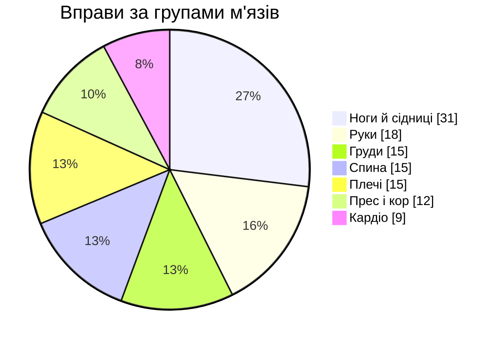
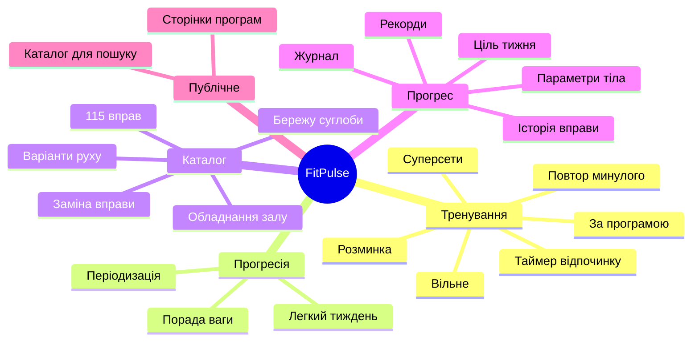

# FitPulse: документація

FitPulse — трекер силових тренувань для телефона в залі. Застосунок працює в браузері й встановлюється на головний екран як PWA. Зараз дані зберігаються на пристрої. Сервер на FastAPI і Postgres уже має фундамент, а подальші кроки описано в розділі [«Бекенд»](./backend.md).

| Розділ | Що всередині |
|---|---|
| [Архітектура](./architecture.md) | Шари коду, фічі, стан, сховище, збірка й офлайн-режим |
| [Логіка тренувань](./workout-logic.md) | Як іде тренування, таймери, прогресія, періодизація, суперсети |
| [Бекенд](./backend.md) | FastAPI, Postgres (Neon) і Docker: архітектура, модель даних, синхронізація, API, етапи |
| [Якість](./quality.md) | Тести, CI, бюджет розміру, Lighthouse |

## FitPulse у цифрах

| | |
|---|---|
| Вправ у каталозі | 115 з фото-демонстрацією та технікою |
| Готових програм | 19, від 2 до 6 днів на тиждень |
| Публічних сторінок для пошуковиків | 135 (каталог, вправи, програми) |
| Юніт- і компонентних тестів | 477 у 51 файлі |
| Тестів бекенду | 14 на справжньому Postgres |
| E2E-сценаріїв | 17 на емуляції Pixel 7 |
| Вхідний JS (gzip) | ≈ 136 КБ, бюджет 140 КБ |

## Головні можливості

