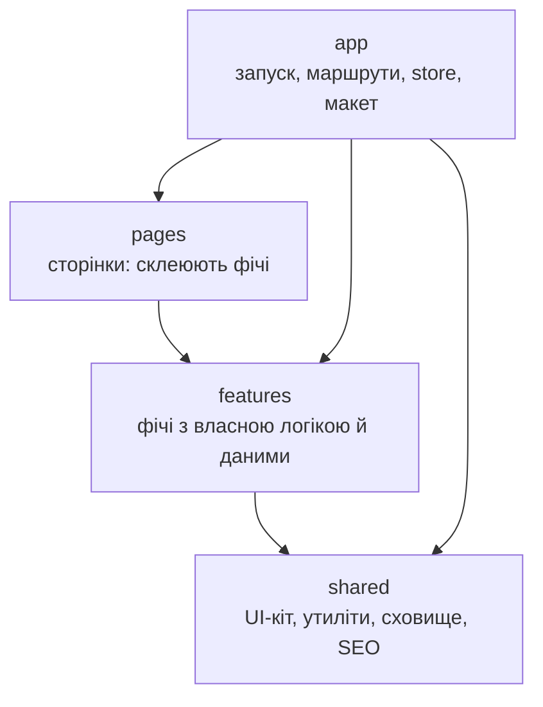
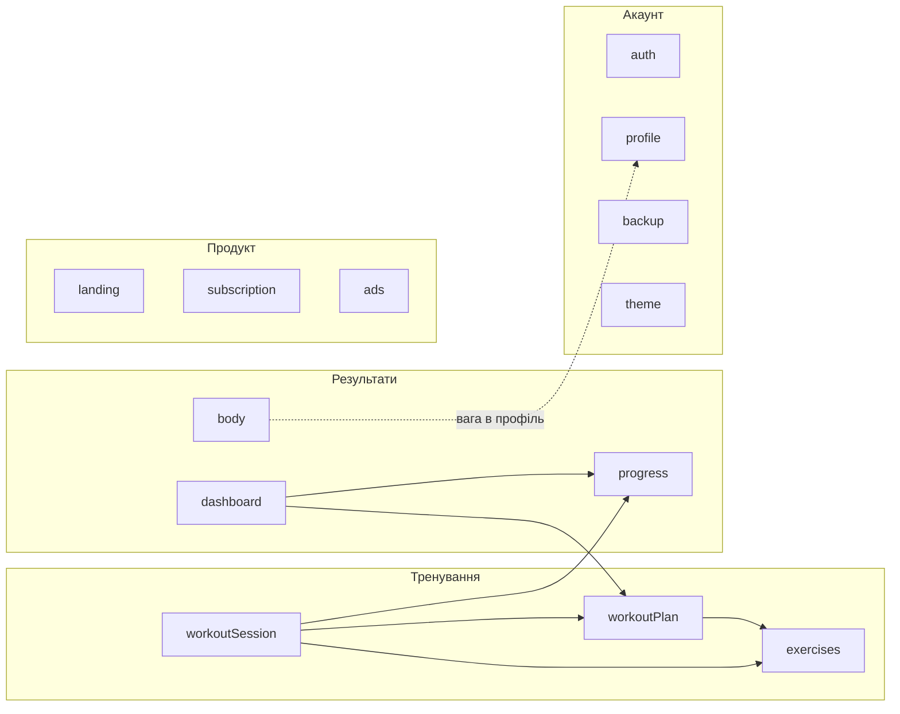
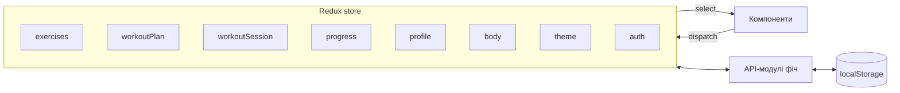
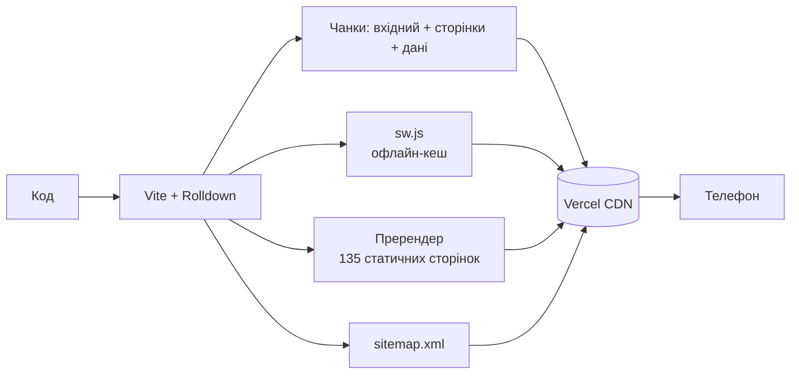

# Архітектура

FitPulse — односторінковий застосунок на React 19 і TypeScript. Збірка — Vite, стилі — Tailwind 4, стан — Redux Toolkit, маршрути — React Router 7. Хостинг — Vercel, сервера поки немає.

## Шари коду

Код поділено на чотири шари. Кожен може імпортувати лише ті, що нижче; правило перевіряє лінтер.

Кожна фіча відкриває назовні три точки входу:

| Точка входу | Для чого | Хто імпортує |
|---|---|---|
| `@/features/x` | Компоненти й хуки | Сторінки, що вантажаться ліниво |
| `@/features/x/model` | Redux-слайс, типи, чиста логіка | Store, інші фічі, ранній код |
| `@/features/x/catalog` | Вбудовані дані (вправи, програми) | Публічні сторінки й пререндер |

Так у вхідний бандл не потрапляють компоненти й великі дані.

## Фічі

Реакції між фічами, наприклад «новий вимір ваги оновлює профіль», живуть в одному місці: `app/store/listeners.ts`. Тож фічі не залежать одна від одної в обидва боки.

## Стан

- Слайси з даними акаунта (`exercises`, `workoutPlan`, `workoutSession`, `progress`, `profile`, `body`) скидаються, коли користувач змінюється. Тема й авторизація лишаються.
- Кожна фіча звертається до сховища лише через свій `api/`. Коли з'явиться сервер, зміняться саме ці модулі, а компоненти й слайси — ні.

## Сховище даних

Усі дані акаунта лежать у `localStorage` з ключем `назва:userId`, тож кілька людей на одному пристрої не бачать даних одне одного.

| Дані | Ключ | Де |
|---|---|---|
| Акаунти й сесія | `fitpulse_accounts_v1`, `fitpulse_auth_session_v1` | localStorage, на пристрій |
| Програми, активна програма | `fitpulse_plans_v1`, `fitpulse_active_plan_id_v1` | localStorage, на акаунт |
| Журнал і рекорди | `fitpulse_history_v1`, `fitpulse_prs_v1` | localStorage, на акаунт |
| Активне тренування | `fitpulse_active_session_v1` | localStorage, на акаунт |
| Профіль і параметри тіла | `fitpulse_profile_v1`, `fitpulse_body_log_v1` | localStorage, на акаунт |
| Власні вправи, обране, нотатки | `fitpulse_exercises_v1`, `fitpulse_favorites_v1`, `fitpulse_exercise_notes_v1` | localStorage, на акаунт |
| Обладнання, суглоби, ціль тижня | `fitpulse_my_equipment_v1`, `fitpulse_my_limits_v1`, `fitpulse_weekly_goal_v1` | localStorage, на акаунт |
| Тема, налаштування таймера | `fitpulse_theme_v1`, `fitpulse_timer_settings_v1` | localStorage, на пристрій |
| Фільтри, чернетки, сторінка повернення | `fitpulse_*_view_v1` та ін. | sessionStorage, на вкладку |

Резервна копія в профілі вивантажує всі дані акаунта в JSON і відновлює з нього.

## Збірка й доставка

- **Ліниве завантаження.** Кожна сторінка — окремий чанк, каталог вправ і програм теж. Вхідний JS ≈ 136 КБ gzip.
- **Пререндер.** Після збірки плагін записує статичний HTML для `/catalog`, кожної вправи й програми з власними заголовками й schema.org. Пошуковики бачать вміст без JavaScript.
- **Офлайн.** Service worker кешує оболонку застосунку, а фото вправ і шрифти — під час першого використання. Тренування працює без мережі.
