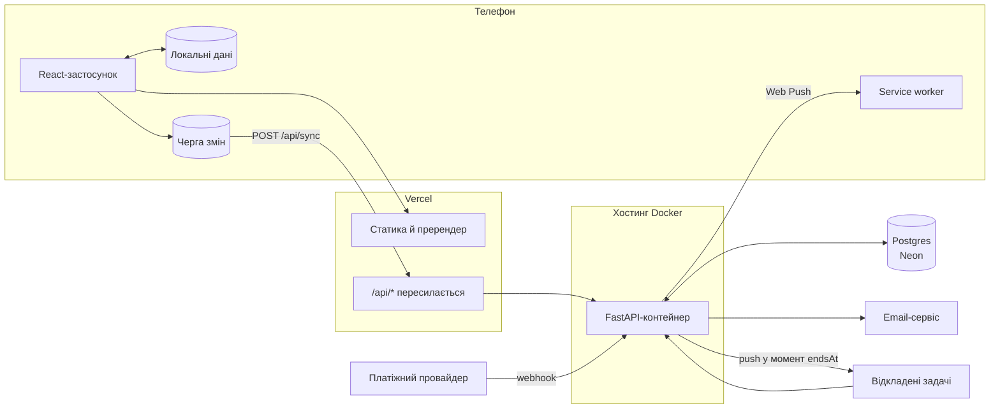
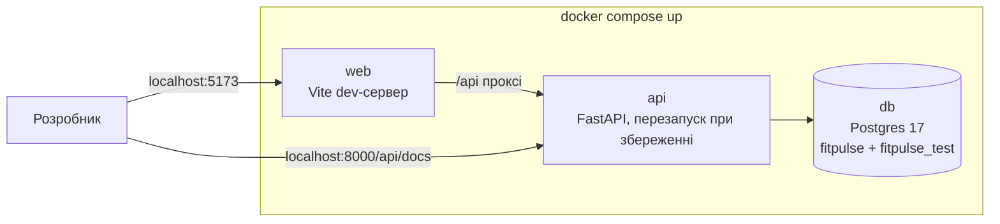
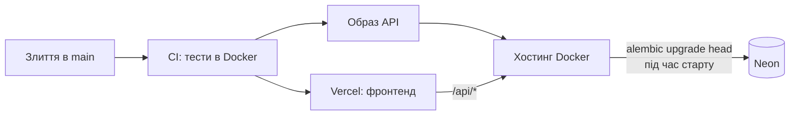
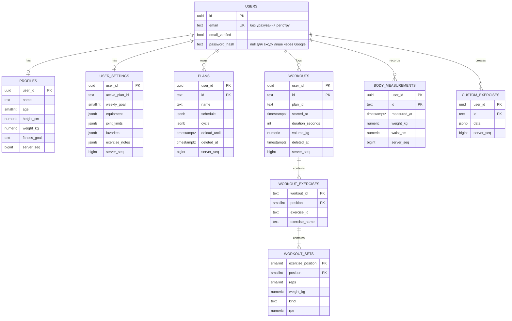
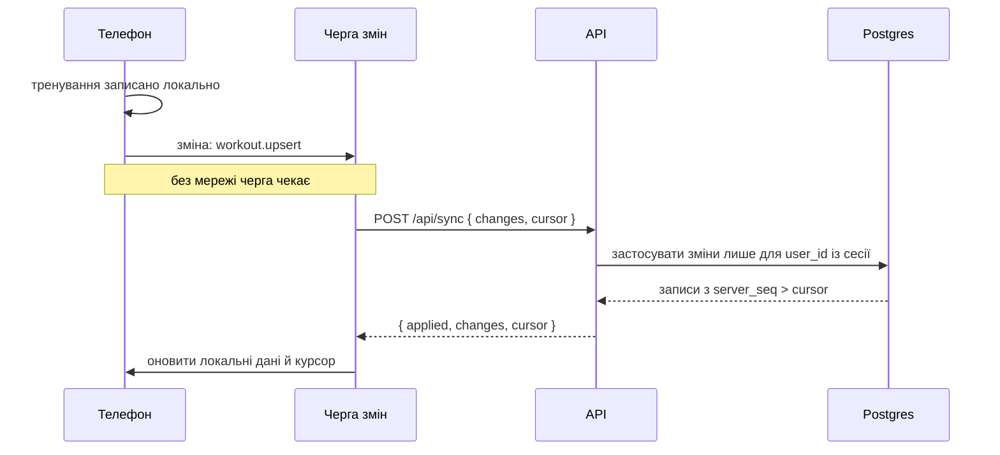
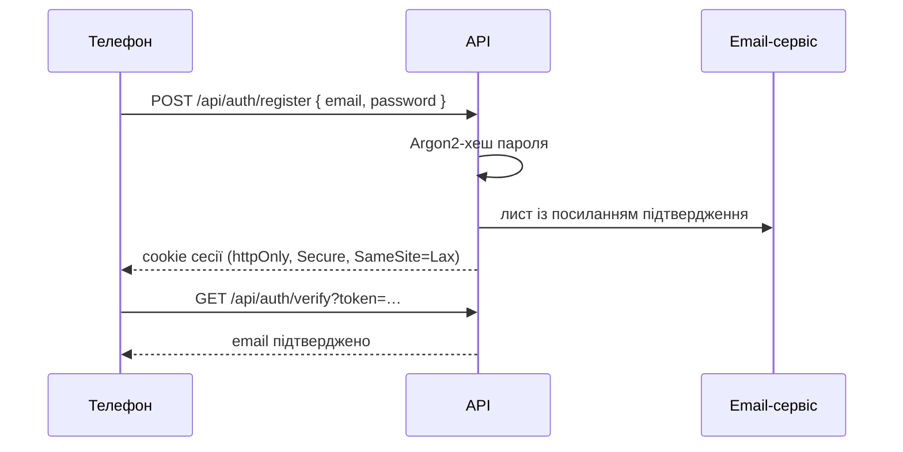
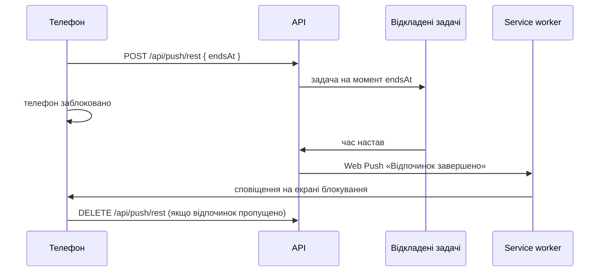
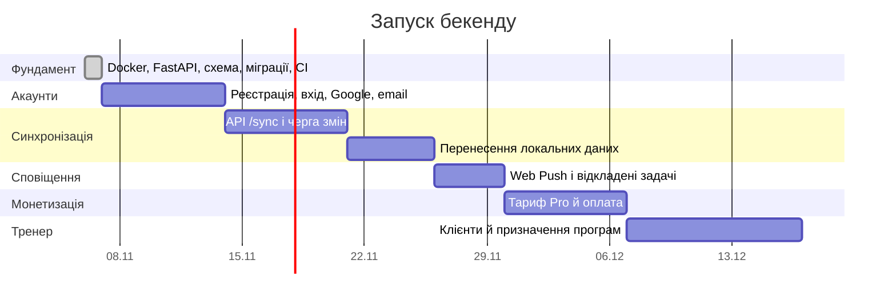

# Бекенд

Зараз усі дані живуть у браузері. Сервер потрібен для чотирьох речей: справжніх акаунтів, синхронізації між пристроями, push-сповіщень точно за часом і оплати Pro. Нижче описано, як зробити так, щоб у залі з поганим зв'язком застосунок працював, як і зараз.

## Принципи

1. **Офлайн насамперед.** Тренування записується на телефоні миттєво й без мережі, а сервер отримує зміни, коли з'являється зв'язок.
2. **Клієнт майже не змінюється.** Компоненти й Redux-слайси лишаються як є. Міняються лише модулі `api/` у фічах: вони пишуть локально й ставлять зміну в чергу на відправку.
3. **Усе в Docker.** Одна команда піднімає базу, API й фронтенд. Той самий образ API, що проходить тести в CI, іде в продакшен.
4. **Один домен.** Застосунок звертається до `/api` на своєму ж домені. У розробці запити пересилає Vite, у продакшені Vercel, тож cookies сесії працюють без CORS.
5. **Типи з одного джерела.** Схеми запитів описані в FastAPI (Pydantic), а TypeScript-типи для клієнта генеруються з OpenAPI.

## Стек

| Частина | Вибір | Чому |
|---|---|---|
| API | Python 3.13, FastAPI | Швидко писати, валідація Pydantic, документація OpenAPI без додаткової роботи |
| База | Postgres 17, у продакшені Neon | Звичайний Postgres; Neon має безкоштовний старт і гілки бази на кожен PR |
| Доступ до бази | SQLAlchemy 2 (async) + asyncpg | Типізовані моделі, повний SQL, коли він потрібен |
| Міграції | Alembic | Версії схеми в git; CI перевіряє, що моделі й міграції збігаються |
| Паролі й сесії | Argon2 + сесія в cookie `httpOnly` | Без сторонніх сервісів авторизації; сесію можна відкликати на сервері |
| Вхід через Google | OAuth 2.0 (Authlib) | Стандартний потік з редиректом |
| Листи | Resend або аналог | Підтвердження email і скидання пароля |
| Тести | pytest на справжньому Postgres | Тригери, каскади й унікальність перевіряються там, де вони працюють |
| Лінтер | Ruff | Перевірка й форматування однією утилітою |

## Архітектура



## Локальна розробка



- `docker compose up` піднімає все: застосунок на `localhost:5173`, документацію API на `localhost:8000/api/docs`.
- API під час старту застосовує міграції, тому база завжди має актуальну схему.
- Тести бекенду запускаються в тому самому контейнері (`docker compose exec api pytest`) на окремій базі `fitpulse_test`.

## Продакшен



- Продакшен-образ запускається від звичайного користувача, а не від root, і не містить тестів та інструментів розробки.
- Перевірка здоров'я контейнера не звертається до бази. Neon «засинає», коли запитів немає, і через це контейнер не повинен перезапускатися.
- Рядок підключення Neon задається лише змінною `DATABASE_URL` на хостингу і не потрапляє в git.

## Модель даних

Записи, які створює телефон, зберігають його текстові id (`plan-1730…`, `body-…`). Тому локальні дані переносяться в акаунт без перетворень. Первинний ключ складається з пари `(user_id, id)`, бо в двох людей можуть збігтися локальні id.

Програми зберігаються як один документ (`schedule` у JSONB), бо їх редагують цілком. Тренування, вправи й підходи є окремими рядками, щоб прогрес рахувався SQL-запитами.



- **Вбудовані вправи й шаблони програм** лишаються в коді, бо вони однакові для всіх. База зберігає лише id вправи (`ex-bench-press`), а її назву — копією, щоб журнал читався й після видалення власної вправи.
- **Особисті рекорди не зберігаються.** Їх рахує запит із найкращих підходів.
- **Видалення м'яке.** Поле `deleted_at` замість фізичного видалення, щоб інші пристрої дізналися, що запис зник.
- **Звіти про помилки** лежать в окремій таблиці без id користувача, імені чи email.

## Синхронізація

Кожен запис, який синхронізується, має `server_seq` — номер з однієї спільної послідовності. Тригер у базі видає новий номер при кожній вставці чи зміні. Пристрій просить «усе після номера, який я бачив останнім», тож годинник телефона не впливає на те, що він отримає.



| Дані | Правило конфлікту |
|---|---|
| Тренування, підходи, виміри тіла | Лише додаються. Редагування й видалення застосовуються за останнім `updated_at` |
| Програми, профіль, налаштування | Перемагає новіша зміна (`updated_at`) |
| Активне тренування | Не синхронізується: живе на одному телефоні, поки не завершене |

Під час першого входу після запуску сервера застосунок запропонує завантажити наявні локальні дані в акаунт. Демо-дані не завантажуються.

## Акаунти



Сесія — це випадковий токен у cookie. На сервері зберігається лише його хеш, тож вихід на одному пристрої чи «вийти всюди» спрацьовують одразу.

## Push-сповіщення



Нагадування в день тренування надсилає задача за розкладом. На iPhone Web Push працює, якщо FitPulse додано на головний екран (iOS 16.4+).

## API

| Метод і шлях | Що робить | Стан |
|---|---|---|
| `GET /api/health` | API й база доступні; версія збірки | готово |
| `GET /api/health/live` | Процес працює (для перевірки контейнера) | готово |
| `POST /api/errors` | Приймає звіти про помилки з застосунку (`VITE_ERROR_ENDPOINT=/api/errors`) | готово |
| `POST /api/auth/*` | Реєстрація, вхід, вихід, Google, підтвердження email, скидання пароля | етап 2 |
| `GET /api/me` | Акаунт, профіль, налаштування, тариф | етап 2 |
| `POST /api/sync` | Відправити локальні зміни й отримати нові за курсором | етап 3 |
| `GET /api/export`, `DELETE /api/me` | Усі дані акаунта в JSON; видалення акаунта | етап 3 |
| `POST /api/push/*` | Підписка пристрою, сповіщення про кінець відпочинку | етап 4 |
| `POST /api/billing/webhook` | Події оплати Pro | етап 5 |

## Безпека

- **Власник даних.** Кожен запит до бази фільтрується за `user_id` із сесії, а не за id із запиту.
- **Обмеження частоти.** Вхід, реєстрація й скидання пароля мають ліміти запитів.
- **Перевірка вхідних даних.** Кожне тіло запиту перевіряє Pydantic. Надто довгі тексти у звітах про помилки обрізаються.
- **Секрети** задаються лише змінними середовища на хостингу.
- **Документація API** (`/api/docs`) у продакшені вимкнена.
- **Видалення й експорт** доступні в профілі, як і зараз. Neon дає відновлення бази на момент часу.

## Структура

```
docker-compose.yml       база, API й фронтенд для розробки
backend/
  Dockerfile             образи dev (перезапуск при збереженні) і prod
  app/
    main.py              застосунок FastAPI
    config.py            налаштування зі змінних середовища
    db.py                підключення, у тому числі до Neon
    models.py            таблиці
    api/                 маршрути
  migrations/            міграції Alembic
  tests/                 pytest на справжньому Postgres
src/                     клієнт, як зараз
```

## Етапи



## Рішення

| Питання | Рішення |
|---|---|
| Мова й фреймворк API | Python, FastAPI |
| Запуск | Docker: compose для розробки, той самий образ у продакшені |
| База | Neon (Postgres) |
| Листи | Resend або аналог, акаунт створює власник проєкту |
| Хостинг контейнера API | Ще не обрано. Підходить будь-який, що запускає Docker-образ поруч із регіоном Neon (Франкфурт): Google Cloud Run, Fly.io, Koyeb, Railway |
| Платіжний провайдер | Сервіс, що працює з українськими ФОП: LiqPay, WayForPay, monobank |
| Акаунти, створені до сервера | Користувач входить, підтверджує email, і його локальні дані переносяться в акаунт |
