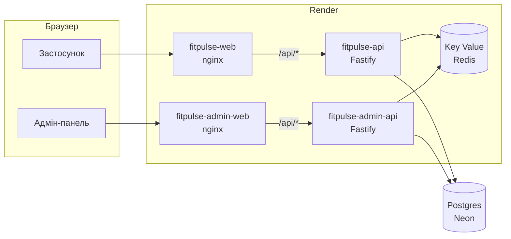
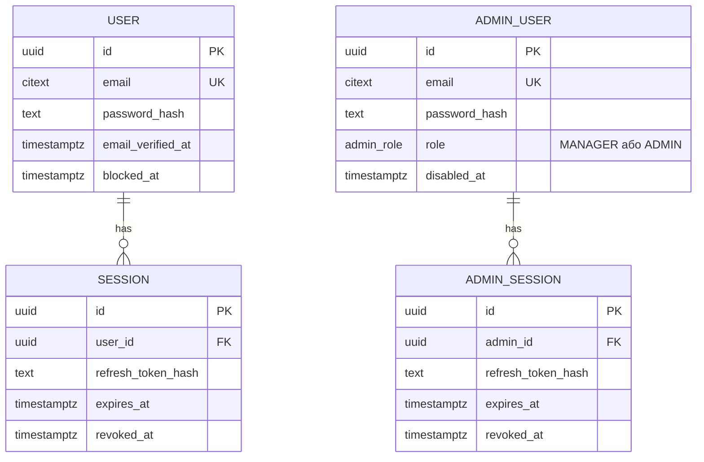
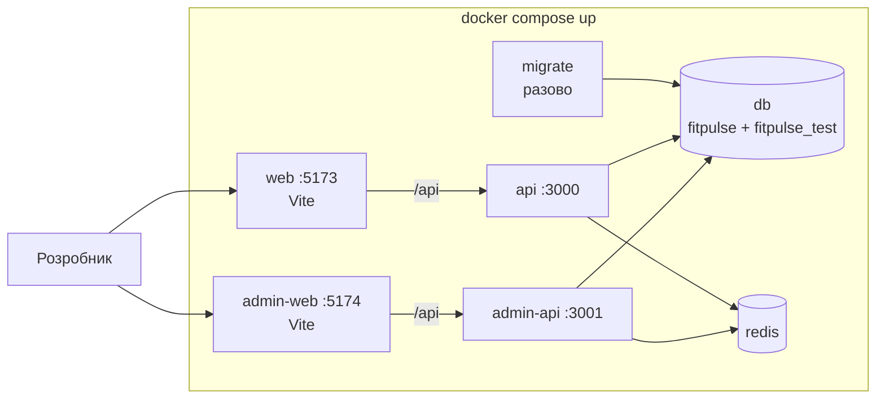
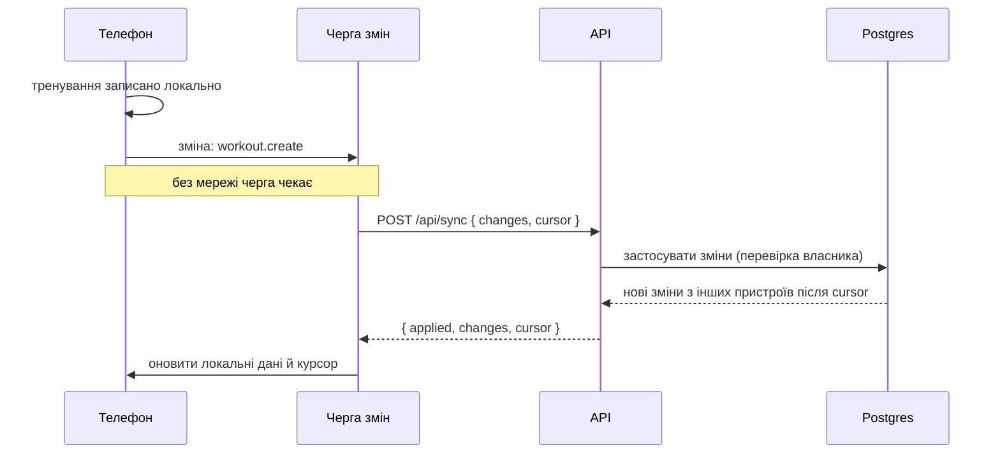

# Бекенд

Зараз дані застосунку живуть у браузері. Сервер потрібен для справжніх акаунтів, синхронізації між пристроями, адмін-панелі, push-сповіщень і оплати Pro. Застосунок має й далі працювати в залі без зв'язку.

Рішення й обґрунтування етапу 1: [специфікація](./superpowers/specs/2026-11-06-backend-foundation-design.md).

## Принципи

1. **Офлайн насамперед.** Тренування записується на телефоні миттєво й без мережі, а сервер отримує зміни, коли з'являється зв'язок.
2. **Клієнт майже не змінюється.** Компоненти й Redux-слайси лишаються. Міняються модулі `api/` у фічах: вони пишуть локально й ставлять зміну в чергу на відправку.
3. **Усе в Docker.** Кожна частина — Docker-образ. Локально все піднімає одна команда, а в продакшені ті самі образи запускає Render.
4. **Один домен для браузера.** Кожен фронт віддає nginx, який пересилає `/api/*` на свій бекенд. Cookie сесії тому лишається своєю для сайту без CORS.
5. **Спільні контракти.** Zod-схеми з `packages/contracts` перевіряють запити на сервері й відповіді на клієнті.

## Стек

| Частина | Вибір |
|---|---|
| API | Node.js 24, Fastify 5, TypeScript, валідація Zod (`fastify-type-provider-zod`) |
| База | Postgres 17 локально, у продакшені Neon (безкоштовна база без терміну дії) |
| ORM і міграції | Prisma 7 з адаптером `pg`, міграції в git |
| Кеш, сесії, ліміти | Redis 7 локально, Render Key Value у продакшені |
| Авторизація | JWT: access-токен на 15 хвилин у пам'яті, refresh-токен у cookie `httpOnly` з ротацією |
| Хостинг | Render: чотири Docker-сервіси й Key Value з `render.yaml` |
| Тести | Vitest: юніт без бази, інтеграційні на справжніх Postgres і Redis |

## Частини

| Папка | Пакет | Що це |
|---|---|---|
| `frontend/` | `@fitpulse/web` | застосунок |
| `frontend-AdminPanel/` | `@fitpulse/admin-web` | адмін-панель для ролей `manager` і `admin` |
| `backend/` | `@fitpulse/api` | API застосунку, порт 3000 |
| `backend-AdminPanel/` | `@fitpulse/admin-api` | API адмінки, порт 3001, окремий `ADMIN_JWT_SECRET` |
| `packages/contracts/` | `@fitpulse/contracts` | Zod-схеми й типи для всіх частин |
| `packages/server-core/` | `@fitpulse/server-core` | спільний каркас бекендів: конфіг, помилки, health, Redis |
| `packages/db/` | `@fitpulse/db` | схема Prisma, міграції, сід першого адміна |

Фронти не імпортують бекенди, `db` і `server-core`. Бекенди не імпортують один одного.

## API етапу 1

| Метод і шлях | Що робить |
|---|---|
| `GET /api/health` | `{ status: "ok" }`, не звертається до бази: Render не перезапускає сервіс, коли Neon спить |
| `GET /api/health/ready` | перевіряє Postgres і Redis (по 2 секунди на перевірку): 200 або 503 з переліком |

Помилки завжди мають одну форму: `{ error: { code, message, details? } }`. Помилки валідації повертають 400 з полями, невідомий маршрут — 404, а внутрішня помилка — 500 без подробиць назовні.

## Модель даних етапу 1

- Користувачі й адміністратори лежать в окремих таблицях: акаунт застосунку не стане адміном через помилку в правах.
- Email має тип `citext`, тож `Ann@x.com` і `ann@x.com` — той самий акаунт.
- Сесія зберігає лише хеш refresh-токена й видаляється разом із користувачем.
- Таблиці програм, тренувань і решти даних додадуть міграції етапу 3.

## Локальна розробка

- `migrate` один раз збирає спільні пакети й накочує міграції. API стартують, коли база й Redis здорові, а `migrate` завершився.
- Код змонтовано з диска, тож API перезапускаються після збереження, а Vite оновлює сторінку.
- Команди для сіду адміна й інтеграційних тестів — у [README](../README.md#запуск).

## Продакшен на Render

- `render.yaml` описує `fitpulse-api`, `fitpulse-admin-api`, `fitpulse-web`, `fitpulse-admin-web` і `fitpulse-redis` у регіоні Frankfurt. Render сам збирає й деплоїть сервіс після злиття в `main`, якщо змінилася його папка чи спільні пакети.
- Під час створення Blueprint Render питає `DATABASE_URL`, публічні адреси API (`API_UPSTREAM`) і `VITE_SITE_URL`. JWT-секрети генерує сам.
- Міграції накочує контейнер `fitpulse-api` перед стартом (`RUN_MIGRATIONS=true`): pre-deploy команда Render доступна лише на платному тарифі. Якщо база недоступна, контейнер пробує тричі й однаково запускає API: `/api/health` відповідає, а `/api/health/ready` показує, що бази немає. Наступний старт повторить міграції.
- Міграціям потрібне пряме з'єднання. У Neon для застосунку можна взяти адресу з `-pooler` у `DATABASE_URL`, а пряму покласти в `DIRECT_DATABASE_URL`: її читає лише Prisma CLI.
- Безкоштовні сервіси засинають після 15 хвилин без запитів, і перший запит після цього чекає близько хвилини. Тренування працює офлайн, тому для застосунку це прийнятно. Для стабільної роботи потрібен платний тариф.

## Авторизація (етап 2)

- Вхід видає access JWT на 15 хвилин (застосунок тримає його в пам'яті) і refresh-токен на 30 днів у cookie `httpOnly`, `Secure`, `SameSite=Lax`.
- Refresh-токен міняється на новий після кожного використання. Якщо старий прийшов повторно, значить його вкрали, і вся сесія відкликається.
- Redis кешує відкликані сесії й обмежує частоту входу, реєстрації та скидання пароля.
- Адміни мають окремий секрет підпису, сесію на 8 годин і роль `manager` або `admin` у токені.

## Синхронізація (етап 3)

Кожен запис має id, створений на телефоні (UUID), `updated_at` і `deleted_at` замість фізичного видалення. Сервер видає курсор — зростаючий номер зміни, тож годинник телефона не впливає на те, що завантажиться.

| Дані | Правило конфлікту |
|---|---|
| Тренування, підходи, виміри тіла | Лише додаються; редагування й видалення — за останнім `updated_at` |
| Програми, профіль, налаштування | Перемагає новіша зміна (`updated_at`) |
| Активне тренування | Не синхронізується: живе на одному телефоні, поки не завершене |

## Етапи

| Етап | Що входить |
|---|---|
| 1. Фундамент | Структура, Docker, обидва бекенди з health, Prisma й перша міграція, CI, Render ✅ |
| 2. Акаунти | Реєстрація, вхід, refresh, вихід, скидання пароля, вхід адмінів |
| 3. Синхронізація | Таблиці даних, `POST /api/sync`, черга змін на клієнті, перенесення локальних даних |
| 4. Адмінка | Підтримка користувачів, контент (каталог вправ і програм переходить у базу), статистика й підписки |
| 5. Сповіщення й оплата | Web Push про кінець відпочинку, тариф Pro |

## Безпека

- **Паролі** хешуються argon2id на сервері.
- **Власник даних.** Кожен запит до бази фільтрується за `user_id` із токена, ніколи за id із запиту.
- **Секрети** лише в налаштуваннях Render, у репозиторії — тільки приклади для розробки.
- **Контейнери** працюють не від root.
- **Помилки** назовні не розкривають подробиць, а повний текст лишається в логах сервера.
