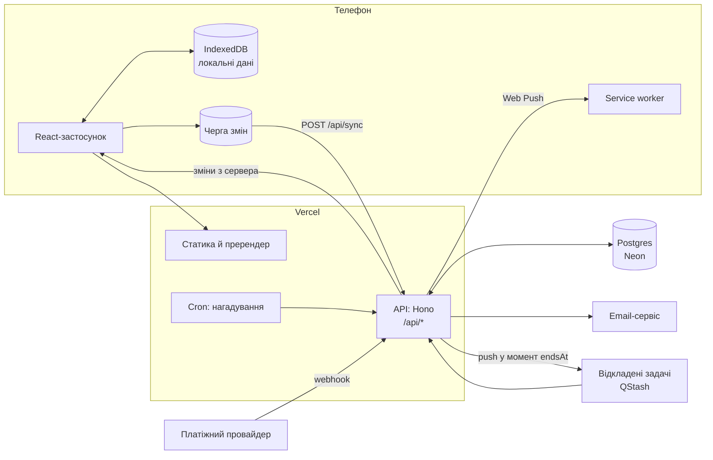
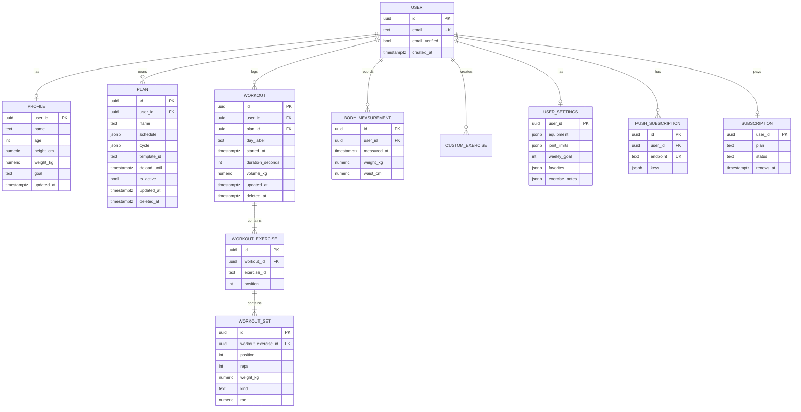
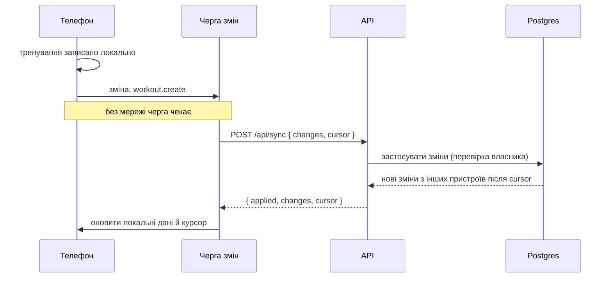
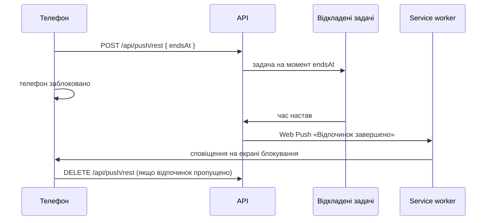
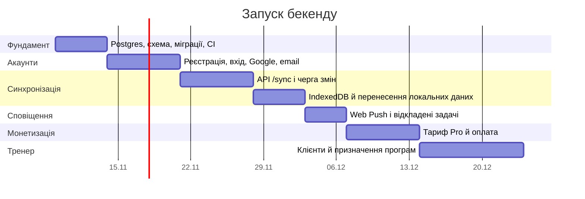

# Бекенд: план

Зараз усе живе в браузері. Сервер потрібен для чотирьох речей: справжніх акаунтів, синхронізації між пристроями, push-сповіщень точно за часом і оплати Pro. Нижче — як це зробити так, щоб у залі з поганим зв'язком застосунок працював як і зараз.

## Принципи

1. **Офлайн насамперед.** Тренування записується на телефоні миттєво й без мережі. Сервер отримує зміни, коли зв'язок з'являється.
2. **Клієнт майже не змінюється.** Компоненти й Redux-слайси лишаються; міняються лише модулі `api/` у фічах: вони пишуть локально й ставлять зміну в чергу на відправку.
3. **Один репозиторій, один деплой.** API — функції Vercel поруч із фронтендом на тому самому домені, тож cookies і CORS не потрібно налаштовувати окремо.
4. **Спільні контракти.** Zod-схеми, якими клієнт уже перевіряє форми й резервні копії, перевіряють і запити на сервері.

## Варіанти стеку

| | Vercel Functions + Postgres (Neon) | Supabase | Firebase |
|---|---|---|---|
| База | Postgres, гілка БД на кожен PR | Postgres | NoSQL (Firestore) |
| Авторизація | Better Auth у нашому коді | Вбудована | Вбудована |
| Офлайн-синхронізація | Власна, проста й прозора | Власна поверх API | Вбудована, але NoSQL |
| Залежність від провайдера | Низька: звичайний Postgres і Node | Середня | Висока |
| Звіти й аналітика по підходах | SQL | SQL | Складно |
| Вартість на старті | Безкоштовні тарифи | Безкоштовний тариф | Безкоштовний тариф |

**Рекомендація: Vercel Functions + Postgres (Neon) + Better Auth + Drizzle ORM.** Це звичайний Postgres і TypeScript без прив'язки до одного провайдера, а підходи й рекорди зручно рахувати SQL-запитами. Supabase — добра альтернатива, якщо важливіше швидко отримати готову авторизацію.

## Архітектура



## Модель даних

Програми зберігаються як один документ (`schedule` у JSONB): їх редагують цілком, і так простіше синхронізувати. Тренування й підходи — окремі рядки: їх лише додають, а аналітика рахує по них.



Вбудовані вправи й шаблони програм лишаються в коді (вони однакові для всіх). У базі — лише id вправи (`ex-bench-press`). Особисті рекорди не зберігаються: це SQL-представлення з найкращих підходів.

## Синхронізація

Кожен запис має id, створений на телефоні (UUID), `updated_at` і `deleted_at` замість фізичного видалення. Сервер видає курсор — зростаючий номер зміни, тож годинник телефона не впливає на те, що завантажиться.



| Дані | Правило конфлікту |
|---|---|
| Тренування, підходи, виміри тіла | Лише додаються; редагування й видалення — за останнім `updated_at` |
| Програми, профіль, налаштування | Перемагає новіша зміна (`updated_at`) |
| Активне тренування | Не синхронізується: живе на одному телефоні, поки не завершене |

Під час першого входу після запуску сервера застосунок пропонує завантажити наявні локальні дані в акаунт. Демо-дані не завантажуються.

## Push-сповіщення



Щоденні нагадування в день тренування надсилає Cron. На iPhone Web Push працює для FitPulse на головному екрані, iOS 16.4+.

## API

| Метод і шлях | Що робить |
|---|---|
| `POST /api/auth/*` | Реєстрація, вхід, вихід, Google, підтвердження email, скидання пароля (Better Auth) |
| `GET /api/me` | Акаунт, профіль, налаштування, тариф |
| `POST /api/sync` | Відправити локальні зміни й отримати нові з курсором |
| `GET /api/export` | Усі дані акаунта в JSON |
| `DELETE /api/me` | Видалити акаунт і всі дані |
| `POST /api/push/subscribe` | Зберегти push-підписку пристрою |
| `POST /api/push/rest`, `DELETE /api/push/rest` | Запланувати чи скасувати сповіщення про кінець відпочинку |
| `POST /api/errors` | Приймати звіти про помилки (`VITE_ERROR_ENDPOINT`) |
| `POST /api/billing/webhook` | Події оплати Pro |

## Безпека

- **Паролі** хешуються на сервері. Сесія — у cookie `httpOnly`, `Secure`, `SameSite=Lax`, на тому самому домені.
- **Власник даних.** Кожен запит до бази фільтрується за `user_id` із сесії, ніколи за id із запиту.
- **Обмеження частоти.** Вхід, реєстрація й скидання пароля мають ліміти запитів.
- **Перевірка вхідних даних.** Тіла запитів перевіряються Zod-схемами, тими самими, що на клієнті.
- **Мінімум персональних даних.** Звіти про помилки не містять імені чи email.
- **Видалення й експорт.** Обидва доступні в профілі, як і зараз.
- **Резервні копії бази** з відновленням на момент часу.

## Структура репозиторію

```
api/[[...route]].ts   вхід для функцій Vercel
server/
  app.ts              маршрути Hono
  auth.ts             Better Auth
  db/schema.ts        таблиці Drizzle й міграції
  sync.ts             застосування змін і курсор
  push.ts             Web Push і відкладені задачі
src/                  клієнт, як зараз
src/shared/contracts  Zod-схеми, спільні для клієнта й сервера
```

## Етапи



## Що потрібно вирішити перед стартом

| Питання | Рекомендація |
|---|---|
| Провайдер бази | Neon (Postgres, безкоштовний старт, гілки на PR) |
| Відправка листів | Resend або аналог із безкоштовним тарифом |
| Тариф хостингу | Безкоштовний тариф Vercel підходить для некомерційного проєкту. Коли з'явиться оплата Pro, потрібен комерційний тариф |
| Платіжний провайдер | Сервіс, що працює з українськими ФОП: LiqPay, WayForPay, monobank |
| Акаунти, створені до сервера | Користувач входить, підтверджує email, і його локальні дані переносяться в акаунт |
