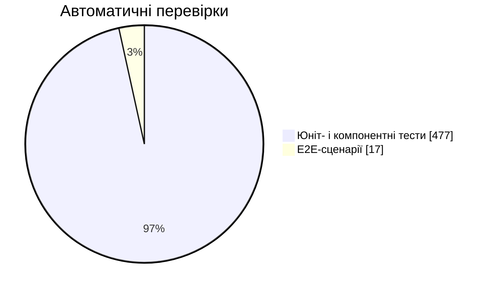
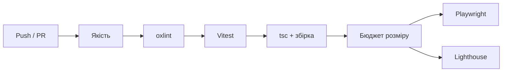
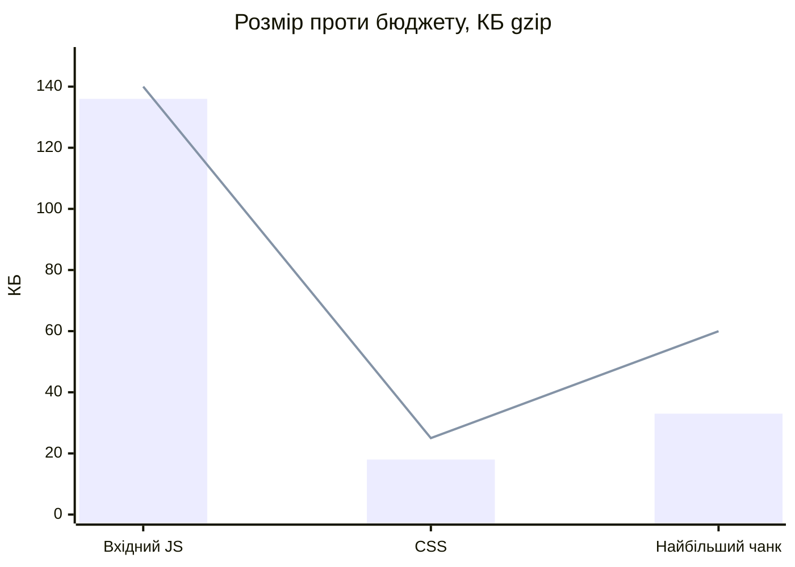

# Якість

## Тести

| Рівень | Інструмент | Що перевіряє |
|---|---|---|
| Логіка | Vitest | Прогресія, періодизація, суперсети, таймери з підробленим годинником, пошук, рекорди, синхронізація днів тренувань |
| Компоненти й сторінки | Vitest + Testing Library | Режим тренування зі справжнім store, форми, модальні вікна |
| Наскрізні сценарії | Playwright, Pixel 7 | Реєстрація, тренування до журналу, програми, каталог, публічні сторінки, вимкнений екран |

Тести також перевіряють контент: що в кожної вправи повна техніка й обидва фото, що назви й описи публічних сторінок мають довжину, яку показують пошуковики, і що програми використовують лише вправи з каталогу.

## CI

## Бюджет розміру

Збірка падає, якщо застосунок виростає понад бюджет (gzip):

Вхідний JS — це вхідний скрипт плюс чанки, які він одразу підтягує: React, Redux, маршрутизатор і спільний UI-кіт (≈ 43 КБ). Наступна ціль оптимізації — вантажити UI-кіт по частинах.

## Помилки в продакшені

Неперехоплені помилки, відхилені проміси й падіння, які ловить Error Boundary, перетворюються на короткий звіт. У ньому лише текст помилки, сторінка без параметрів, браузер і версія збірки, без імені, email чи тренувань. Звіт зберігається на пристрої; якщо задано `VITE_ERROR_ENDPOINT`, він також надсилається туди.

## Lighthouse

CI перевіряє `/welcome`, `/login`, `/privacy` і сторінку вправи. Доступність, найкращі практики й SEO — 1,0, продуктивність — 0,99–1,0.
