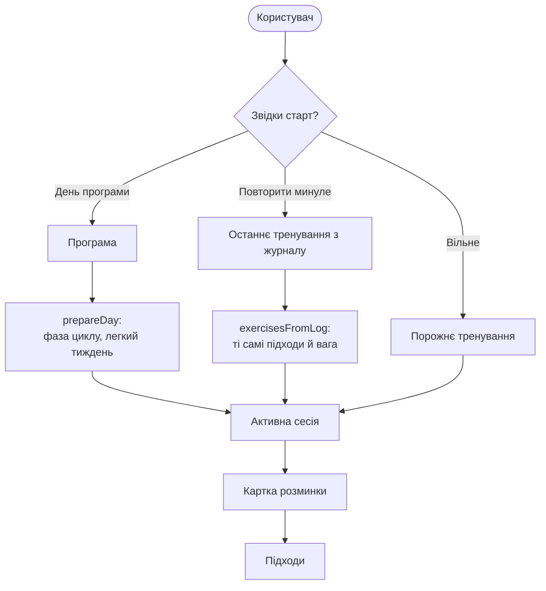
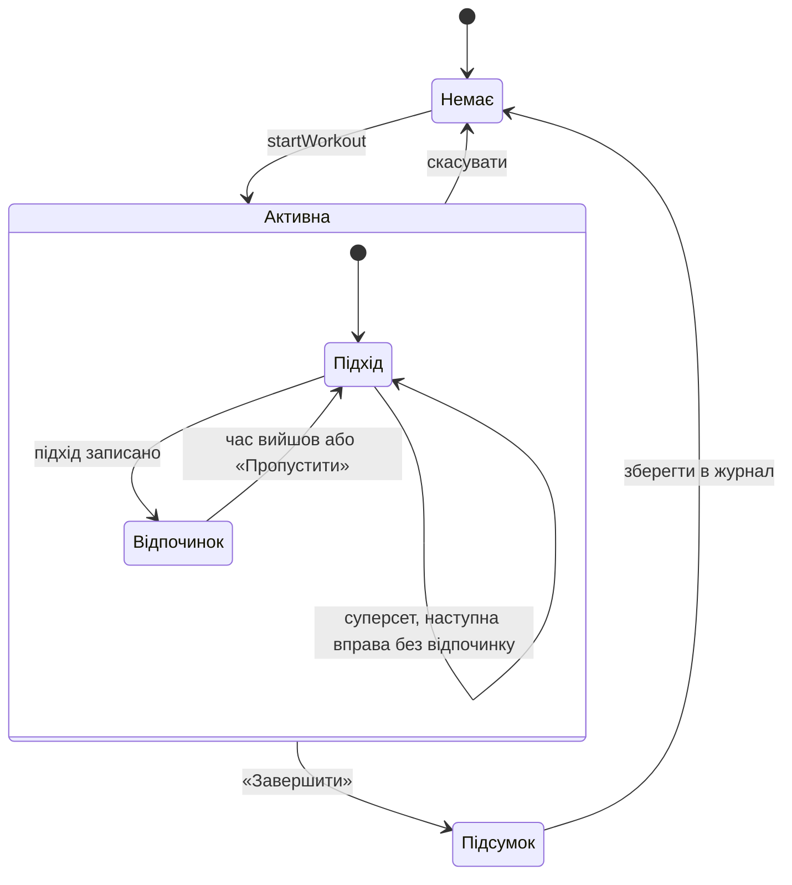
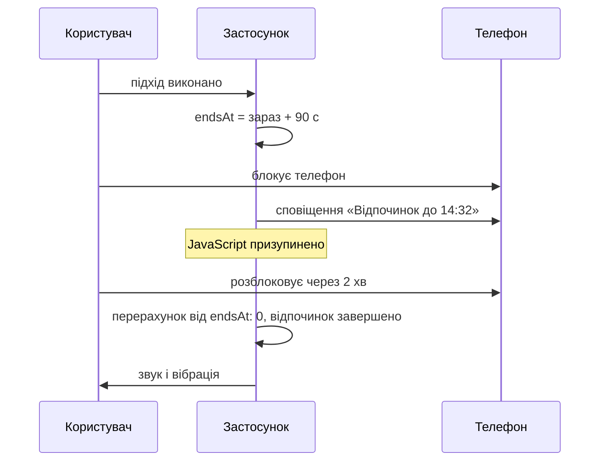
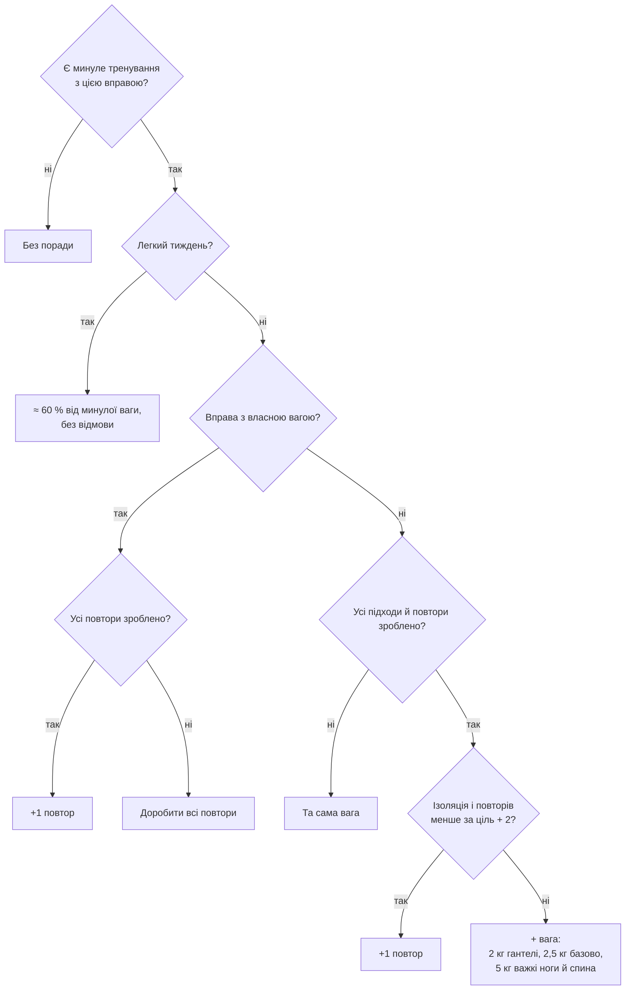
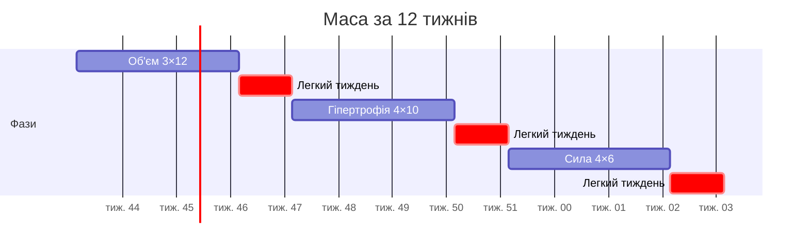
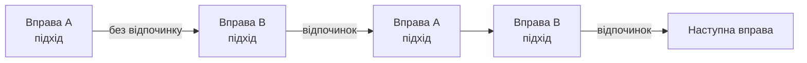

# Логіка тренувань

## Як починається тренування

## Стан сесії

Сесія зберігається після кожної зміни, тож перезавантаження сторінки чи закритий застосунок нічого не губить.

## Таймери за реальним годинником

Коли екран телефона гасне, браузер зупиняє JavaScript. Тому таймери не рахують тики, а зберігають моменти часу:

| Таймер | Що зберігається | Як показується |
|---|---|---|
| Тривалість тренування | `startTime` | `now − startTime` |
| Відпочинок | `endsAt` | `endsAt − now`, зупиняється на нулі |

## Порада ваги (подвійна прогресія)

## Періодизація

Програма з циклом проходить фази, що задають підходи й повтори для всіх вправ. Після кожної фази йде легкий тиждень. Приклад «Маса за 12 тижнів»:

Легкий тиждень можна увімкнути і вручну на 7 днів: на один підхід менше, вага ≈ 60 %.

## Суперсети

## Каталог: варіанти й заміна

- **Варіанти руху.** Жим лежачи зі штангою, гантелями, у Сміті й тренажері — одна картка з перемикачем. Кожен варіант має власний id, тож історія й рекорди не змішуються.
- **Заміна вправи** пропонує вправи на той самий головний м'яз. Вона враховує обладнання залу й «Бережу суглоби», а з однієї групи варіантів бере щонайбільше одну вправу.
- **Пошук** знаходить вправи за сленгом, російською й англійською («бенч», «присед», «bench press») і не зважає на і/и, ё/е та апострофи.
